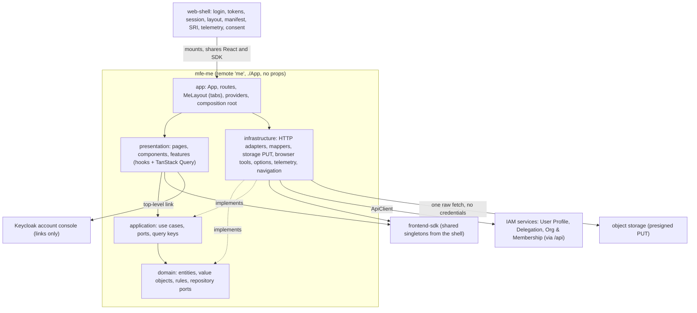

# Architecture refactoring plan (mfe-me)

The Constitution's "Required Output For Architecture Refactoring" for `mfe-me`. This remote was built to the Constitution from its first commit, so the plan is mostly a record: what is done, what deviates and why, and what remains. Items 1, 2 and 7 are in [constitution-assessment.md](constitution-assessment.md) and the [ADRs](../adr); this file adds 3 to 6, 8, 9 and 10.

## 3. Target architecture

Dependencies point inward; `domain` imports nothing; `domain` and `application` have no React, SDK or browser API. Enforced by `npm run arch-lint`, `layers.test.ts` and `structure.test.ts`.

## 4. Folder restructuring plan

**No code moves.** Each folder in the Constitution's tree either exists with code or is recorded as absent, with its content's home and the reason, in [ADR 0007](../adr/0007-constitution-folder-mapping.md); `test/unit/architecture/structure.test.ts` keeps the two in step. The folders not created are `presentation/widgets`, `application/commands`, `application/services`, `infrastructure/auth`, `infrastructure/storage`, `shared/ui`, `shared/types`, `shared/utilities`, and `tests/` inside `src/`. One folder was added: `infrastructure/browser`.

## 5. Dependency cleanup plan

Done during the build; nothing is pending.

| Concern | State |
|---|---|
| Domain → framework, HTTP, storage, TanStack Query | None: `layers.test.ts` fails on a non-relative import or a browser global in `domain/` and `application/` |
| Application → React | None (same test) |
| Presentation → `fetch`, SDK storage/metrics/config, infrastructure | None: only `app/` imports infrastructure; `fetch` is allowed in one file (`signatureStorage.ts`, ADR 0006) |
| TanStack Query outside `app/` and `presentation/features/` | None (`dependency-rules.test.ts`) |
| Duplicated SDK behaviour | Three removed: query retries, a lazy client wrapper, a UUID generator ([implementation-notes](../lld/implementation-notes.md)) |
| Unused or banned dependencies | None found: every `package.json` dependency is referenced; no axios, ky, Redux, Zustand, i18next |
| SDK and preset versions | Equal (`1.0.0-alpha.10`) and never newer than web-shell's (`SdkVersionPlugin` fails the build otherwise) |
| Domain logic shared with another domain | None: nothing is imported from `mfe-admin`, `mfe-tender` or `mfe-dashboard`; the identity components are interim copies (ADR 0003) |

## 6. Migration roadmap

| Step | Status | Notes |
|---|---|---|
| Scaffold, plumbing, domain, adapters, screens, hardening | Done (LLD §1.1 steps 1 to 6) | See `CHANGELOG.md` |
| Structure check against the Constitution | Done (ADR 0007) | |
| Joint browser test with web-shell | Done in Chromium | Firefox and WebKit not run |
| Remove the interim identity components | Waiting | When the shared identity package is published (ADR 0003); a change of imports in two folders |
| Adopt the design system | Waiting | When `platform-design-system` exists (ADR 0003) |
| Signature upload on a real bucket | Waiting on deployment | CSP `connect-src` and CORS (ADR 0006); or an SDK helper that replaces the raw `fetch` |
| IAM gaps the screens wait on | Waiting on IAM | LLD §15 #4 to #12, #21 |
| Align with the platform on Zustand and Vitest | Open question | Two approved deviations (ADRs 0002 and 0005); revisit if the platform standardises |

## 8 to 10. Refactoring, functionality, breaking changes

Nothing needed refactoring to comply, so nothing was moved and no behaviour changed. The one structural change in this pass is additive: a test that holds the folder structure to the Constitution and the ADR that records the deviations. Public contract (container `me`, `./App` with no props, routes, metrics, shared modules) is unchanged.
