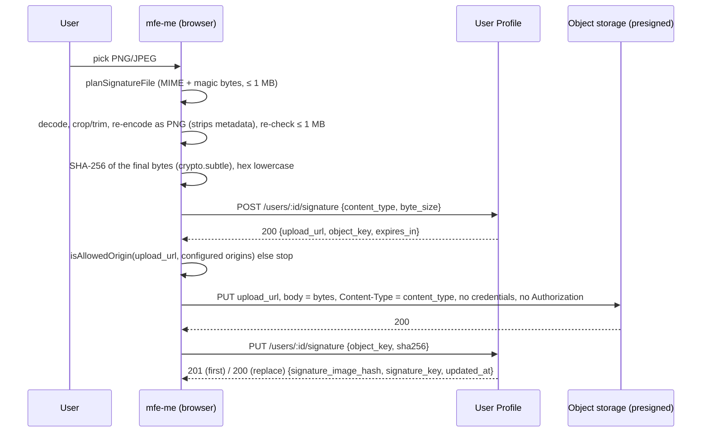

# mfe-me — Low-Level Design

## Tender Management SaaS Platform — Personal Area Remote (`me`)

| | |
|---|---|
| Repository | `BCBP-SOLUTIONS-FZC-LLC/mfe-me` (the repository exists with a README only; no code yet) |
| Status | **Implemented (0.2): the code wins where it differs; see [implementation-notes.md](implementation-notes.md) for every departure.** Originally: draft for review, before any code. Written from the IAM screen spec (G1–G6, §7), the pinned IAM Swagger (`docs/IAM_swagger/iam-user-profile.yaml`, `iam-delegation.yaml`, `iam-org-membership.yaml`), web-shell `0.5.0` as it is on `main`, platform-reactcommon `1.0.0-alpha.10`, and the structure, rules and code of the sibling remote `mfe-admin` (LLD `0.1.17`). Where this document says "inherited", the rule comes from `mfe-admin`'s LLD (and through it `mfe-tender`'s and web-shell's); where it says "proposed", it is a decision for review (§15) |
| Deliverables | Container image `ghcr.io/bcbp-solutions-fzc-llc/mfe-me` and the release `dist` tarball (as `mfe-admin`). `package.json` private; nothing is published to npm |
| Version | `0.1`, 26 November 2026. First release target: none set |
| Narrative | `ARCHITECTURE.md` (to be written with the scaffold, as `mfe-admin`'s); decisions in `docs/adr` (§3, ADRs carried over and one new); metrics in `docs/observability/metrics.md` (§5, §12) |
| Upstream contracts | platform-reactcommon LLD and design doc (`docs/lld/platform-reactcommon-lld.md`, `docs/design/frontend-sdk-design.md`); `iam-product-screen-spec.md` v0.1; the IAM services' Swagger (§14 contract tests); `mfe-admin`'s handoffs, which were copied to this remote: `app-chrome-handoff.md`, `shared-components-and-navigation-handoff.md`, `session-context-refresh-handoff.md`, `sdk-api-client-handoff.md` |
| Host | `web-shell`, mounting this remote at `/t/<slug>/me/*` with `RemoteBoundary remote="me" module="./App"`, no props, `useRouteTemplate('/t/:slug/me')`, loading text "Loading your account…" (`app.loadingAccount`), kill-switch flag `remote.me.disabled`. **web-shell `0.5.0` already has the route** (checked on `main`, `src/app/routes/App.tsx`: `ACCOUNT_REMOTE = 'me'`). Its sidebar shows **My account** (`app.frame.account`) as one link to `/me` when the manifest lists `me`; there is no sub-menu for it (unlike Admin). The local manifest (`config/remotes.local.json`) has no `me` entry yet (§12) |
| Platform SDK | `@bcbp-solutions-fzc-llc/frontend-sdk` `1.0.0-alpha.10` (peer `^1.0.0-alpha.10`, provided by the shell); `webpack-preset` and `eslint-plugin` `1.0.0-alpha.10`. Never newer than web-shell's |
| Runtime | React 19, React Router 7, Tailwind 4 + daisyUI 5; Rsbuild 2 (Rspack); TanStack Query 5; nginx on port 8080 (all inherited from `mfe-admin`) |
| Source of requirements | `iam-product-screen-spec.md` v0.1 (19 Nov 2026), screens **G1–G6**, rules IAM-UX-1…14 (§3), shared components §7, freshness §8, errors §9, API map §11.2–§11.3. "§" references below are to that spec unless stated |
| Siblings | `mfe-admin` (`docs/lld/mfe-admin-lld.md`, whose structure, layering, tooling and test approach this follows), `mfe-tender`, `mfe-dashboard` |
| Not in this remote | E1–E7 (`mfe-admin`), C16 (`mfe-tender`), A1 sign-up (separate app), A2/A4/A5/A6/A8 and banners (web-shell), O1–O4 (operator console), the user menu and Sign out (web-shell's sidebar). Reasoning in §2.2 |

### Revision history

| Version | Date | Change |
|---|---|---|
| 0.1 | 2026-11-26 | First draft, before any code. Structure and tooling carried over from `mfe-admin` `0.1.17`; Swagger findings recorded as open items §15 #3–#11 |
| 0.2 | 2026-11-26 | Implemented. Corrections from the Swagger and the build, in [implementation-notes.md](implementation-notes.md): credentials are name → value (not lists); DLG-4 answers a different shape; retries are the SDK client's only; the client is `useApiClient()`; shared SDK subpaths are auth, config, core, i18n, logging, metrics, nav, problem, react, security; the signature preview is a `data:` URL; message colours are the Aura inks |

### Signoff conditions

Signoff accepts this document as the design baseline. It does not close every open item in §15. Conditions:

1. **Scope (proposed):** G1 (profile edit, revert to directory value, signature upload and removal), G2 (status and note), G3 (my active delegations: list, create, extend, reassign, cancel), G4, G5, G6 (links to the Keycloak account console only). **Not this release:** "delegated to me" and admin views of others' delegations (IAM-FE-Q9), tender-scoped delegations (§15 #7), a preview of the current signature (§15 #4), delegation history and ended reasons (§15 #5).
2. **Signature upload path (§15 #3) — blocks the signature part of G1, not the rest:** the presigned S3 PUT is cross-origin. It needs the storage origin in the platform CSP's `connect-src`, a CORS rule on the bucket for the app's origin, and an agreed way to make the PUT outside the SDK `ApiClient` (which accepts path templates only). Platform deployment and platform-reactcommon to agree.
3. **Shared identity package (`mfe-admin` §15 #5):** until it is published, this remote builds interim copies of the user chip, department label and member picker behind the same ports (ADR 0003 carried over).
4. **Section navigation (§15 #1):** in-page tabs drawn by this remote (proposed) or a web-shell sub-menu like Admin's.
5. **Config-sourced lists accepted as interim:** the allowed AI models (IAM-FE-Q11) and the notification event types (v0.2 FE-Q13) come from runtime configuration until a service publishes them (§15 #9, #10).
6. **Before the affected parts are built:** IAM answers §15 #5, #6, #8 and #11.

### Table of Contents

1. [Document Overview](#1-document-overview)
2. [Responsibilities and Boundaries](#2-responsibilities-and-boundaries)
3. [Architecture and Source Layout](#3-architecture-and-source-layout)
4. [Runtime Contract with the Shell](#4-runtime-contract-with-the-shell)
5. [Platform SDK Usage](#5-platform-sdk-usage)
6. [Domain Model](#6-domain-model)
7. [Key Flows](#7-key-flows)
8. [Authorization (UI hints)](#8-authorization-ui-hints)
9. [i18n](#9-i18n)
10. [State and Storage](#10-state-and-storage)
11. [Failure Handling](#11-failure-handling)
12. [Build, Image, Configuration and Release](#12-build-image-configuration-and-release)
13. [Security](#13-security)
14. [Testing](#14-testing)
15. [Open Items](#15-open-items)

---

## 1. Document Overview

This LLD records how the remote is to be built and what it promises its host: the exposed module, routes, shared modules, SDK dependencies, the domain rules and data it shows, and how it fails. Once code exists, the code wins over this document.

Like `mfe-admin`, **every IAM route this remote calls is Built** (spec §11.2, §11.3), so it has a real backend from the first commit. It calls **three** IAM services from the browser and one storage endpoint:

| Called | For |
|---|---|
| User Profile (`/api/v1/users…`) | G1, G2, G4, G5; names in the delegate picker and delegation list (`users:batch`) |
| Delegation (`/api/v1/delegations…`) | G3 (DLG-1…DLG-6; DLG-7 is admin, in `mfe-admin`) |
| Org & Membership (`/api/v1/tenants/:id/…`, read only) | P-4 (members, for the delegate picker), P-3 (the tenant's departments, for a department scope and their names), P-12 (level labels) |
| Object storage (presigned S3 URL from User Profile) | The signature bytes (G1, IAM-UX-13). Not an API: see §7.3 and §15 #3 |

The Keycloak account console (G6) is reached by top-level links, not calls. Nothing Proposed is called. The audience differs from `mfe-admin`: **every signed-in member** uses this remote, and almost every write is about the caller (`/users/<me>`, `/delegations` as delegator).

### 1.1 Build order (proposed)

Same steps as `mfe-admin` used, so reviewers can compare:

| Step | Content |
|---|---|
| 1 | Scaffold from `mfe-admin` (§3, §12): layers, preset, lint, arch-lint, Rstest, image, CI; `APP_ID = 'me'`; standalone page; empty `MeLayout` and routes |
| 2 | Plumbing: query keys, `ProblemReader`, `MeTelemetry` and the `iam_me_*` metrics, `useMeAccess`, the message catalogue |
| 3 | Domain: entities, value objects, ports, `me-rules.ts` with both-path tests |
| 4 | Adapters, mappers and the pinned-Swagger contract tests (User Profile, Delegation, Org & Membership subset); the signature storage adapter |
| 5 | Screens in the spec's suggested order: G1 (without signature) → G3 → G2 → G4 → G5 → G6; then the G1 signature once §15 #3 is agreed |
| 6 | Hardening: fake IAM and e2e flows, axe, browser suite, smoke, `ARCHITECTURE.md`, constitution assessment |

## 2. Responsibilities and Boundaries

### 2.1 In scope

| Screen | Purpose | Path | Backend status |
|---|---|---|---|
| G1 Profile and signature | Edit my display name, job title, phone, timezone, language, professional credentials; revert federated overrides; upload, replace or remove my signature | `` (index) | Built. Signature: Built, but the browser path needs §15 #3; no read of the current signature (§15 #4) |
| G2 Availability | Set `available` / `busy` / `ooo` with a window and a note | `availability` | Built |
| G3 Delegations | My active delegations; create, extend, reassign, cancel | `delegations` | Built. Active rows only, no ended reason (§15 #5); tender scope not offered (§15 #7) |
| G4 AI preferences | Preferred model, writing tone, prompt templates, context snippets | `ai` | Built. Model list from config (§15 #9) |
| G5 Notification preferences | Channels and minimum urgency per event type | `notifications` | Built. Event-type list from config (§15 #10) |
| G6 Security | Links to the Keycloak account console (MFA methods, passkeys, recovery codes, password, sessions) | `security` | No IAM API (spec G6) |
| Page outlet and section tabs | `MeLayout`: the section tabs (§15 #1), the page outlet and a `MFEErrorBoundary` per page | `app/layouts` | n/a |
| The `me` message catalogue and Tier 3 metrics (`iam_me_*`) | | `infrastructure/` | n/a |

### 2.2 Out of scope (owned elsewhere)

| Concern | Owner |
|---|---|
| Sign-in, MFA enrolment, tokens, session, sign-out, workspace switch | SDK `/auth` in web-shell (Keycloak) |
| App frame: sidebar, "My account" entry, user menu, Sign out, workspace switcher | web-shell `0.5.0` (`AppSidebar`). This remote draws no global navigation |
| MFA methods, passkeys, recovery codes, password, sessions | Keycloak account console (G6 links to it) |
| Whether an action is allowed | IAM and the gateway (AuthZ Enrichment). This remote only hides what the user cannot do |
| Role → UI permission map | web-shell `src/domain/rules/permissions.ts` (no new key needed, §8) |
| P-35 session context | web-shell. This remote reads it through `useSessionContext` and does not call P-35 |
| Admin edits of another user's profile, delegation policy (DLG-7), admin actions on others' delegations | `mfe-admin` (E2, E6); the admin list of all delegations does not exist yet (IAM-FE-Q9) |
| "Delegated to me" work | Dashboard (Workflow), spec G3; IAM-FE-Q9 for an IAM list |
| The drafting preference (auto vs assisted) | Tender (v0.2 G4) |
| Signature use during approval (C10) | `mfe-tender` and Workflow; IAM stores the signature only |
| Hosting, manifest, SRI enforcement, kill switch | Platform deployment, web-shell, SDK `/mfe` |

### 2.3 Remote split (decided in `mfe-admin` §2.3)

| Remote | Container | Mount | Audience | Screens |
|---|---|---|---|---|
| `mfe-admin` | `admin` | `/t/<slug>/admin/*` | Tenant admins and owners | E1–E7 |
| `mfe-me` (this repo) | `me` | `/t/<slug>/me/*` | Every member | G1–G6 |

Both use `ownerDomain: iam`. No code, route, container or manifest entry is shared; the `me` bundle never contains E-screens. Links between `/me` and other remotes go through SDK `navigate()` with the full workspace path (`navigate('admin', '/t/acme/admin/settings')`), never a page load (shared-components handoff §3.2). Release, SRI, kill switch and manifest entry are per remote.

## 3. Architecture and Source Layout

The Frontend Architecture Constitution's layers, exactly as `mfe-admin` §3: six components (`app`, `presentation`, `application`, `domain`, `infrastructure`, `shared`), import directions in brackets, enforced by `npm run arch-lint` (dependency-cruiser) and `test/unit/architecture/layers.test.ts`. One port per backend service.

```
src/
├── env.d.ts
├── app/                              composition root (may import every layer)
│   ├── App.tsx                       federation expose ./App (default App, named workspaceBasename)
│   ├── routes/index.tsx              MeRoutes (one Section per route: template, access check), workspaceBasename
│   ├── providers/                    composition.ts (the adapters, telemetry, navigation, config: the only wiring point),
│   │                                 MeProviders.tsx (one QueryClient per mount, cleared on unmount), queryClient.ts (retry rules)
│   ├── bootstrap/                    main.tsx (standalone entry), remote.ts (remote build placeholder entry)
│   ├── layouts/                      MeLayout (section tabs, page outlet, per-page MFEErrorBoundary)
│   └── styles/                       index.css, aura.css, daisyAuraBridge.css (copied from mfe-admin)
├── presentation/                     UI (application, domain, shared)
│   ├── pages/                        ProfilePage, AvailabilityPage, DelegationsPage, AiPreferencesPage,
│   │                                 NotificationPreferencesPage, SecurityPage; one folder per screen for its parts:
│   │                                 profile/ (ProfileCard, CredentialsEditor, SignatureCard, SignatureCropper, MyAccessCard),
│   │                                 availability/ (AvailabilityForm), delegations/ (DelegationList, CreateDelegationDialog,
│   │                                 ExtendDialog, ReassignDialog, CancelDialog, ScopeField), ai/, notifications/, security/
│   ├── components/                   styles.ts, Dialog, ConfirmDialog, ConflictDialog, LoadFailed, ProblemDetails, DateTimeField,
│   │                                 ListEditor (bounded string lists, G4), identity/ (Avatar, UserChip, DepartmentLabel,
│   │                                 MemberPicker, AvailabilityDot: interim copies, ADR 0003)
│   └── features/                     services.tsx (useMeServices, useMeUseCases), tracked.ts (measured queries and mutations),
│                                     workspace.ts, useProblemText.ts, access/useMeAccess.ts, self/useSelf.ts (my user ID,
│                                     token name fallback), identity/ (useUserProfiles, useDepartmentDirectory),
│                                     profile/, signature/, availability/, delegations/, ai/, notifications/ (one hook file per screen)
├── application/                      use cases and ports, no React, browser or SDK runtime (domain, shared)
│   ├── ports/                        telemetry.ts (MeTelemetry), problems.ts (ProblemReader), navigation.ts (MeNavigation),
│   │                                 options.ts (MeOptions: allowed models, notification event types, enabled locales, upload origins),
│   │                                 media.ts (ImageProcessor: decode, crop, re-encode), hashing.ts (Hasher: SHA-256 hex),
│   │                                 clock.ts (Clock), ids.ts (IdempotencyKeys)
│   ├── queries/                      keys.ts (meKeys(slug): every query key, slug first), userBatcher.ts (carried over)
│   └── use-cases/                    one class per port operation, plus UploadSignatureUseCase (presign → put → confirm);
│                                     createUseCases / MeRepositories in index.ts (ADR 0004 carried over)
├── domain/                           pure TypeScript (nothing)
│   ├── entities/                     MyProfile, Credentials, Availability, Delegation, DelegationPolicy, LlmPreferences,
│   │                                 NotificationPreference, PresignedUpload, MemberOption, TenantDepartment, RoleLabel
│   ├── value-objects/                RecordVersion, Cursor, Instant (UTC), IanaTimeZone, LocaleTag, E164Phone
│   ├── vocabulary.ts                 AVAILABILITY, WRITING_TONES, CHANNELS, URGENCY, DELEGATION_SCOPES, DELEGATION_STATUSES,
│   │                                 SIGNATURE_TYPES, DEPARTMENT_LEVELS, TENANT_ROLES (wire codes as data, §8)
│   ├── rules/me-rules.ts             plan* (§6.3)
│   ├── events/me-events.ts           ME_ACTIONS, ACTION_OUTCOMES, LOAD_RESOURCES, UPLOAD_STAGES (closed metric label sets)
│   └── repositories/                 UserProfilePort, DelegationPort, OrgDirectoryPort, SignatureStoragePort
├── infrastructure/                   implementations (application, domain, shared)
│   ├── api/                          userProfile.ts, delegation.ts, orgDirectory.ts (SDK ApiClient, route templates),
│   │                                 signatureStorage.ts (the one cross-origin PUT, §7.3, ADR 0006), scope.ts, readers.ts,
│   │                                 mappers.ts, problem.ts (errorCode → outcome, retry rule, message key; §11)
│   ├── configuration/                messages.ts, locales/en.json, locales/en/<screen>.json, options.ts (MeOptions from runtime
│   │                                 flags, §12), standalone.ts
│   ├── browser/                      imageProcessor.ts (createImageBitmap + OffscreenCanvas/canvas), sha256.ts (crypto.subtle),
│   │                                 idempotency.ts (crypto.randomUUID), clock.ts
│   ├── federation/navigation.ts      MeNavigation adapter (SDK navigate() with the workspace prefix), account-console URLs
│   └── telemetry/metrics.ts          Tier 3 instruments and the MeTelemetry adapter
└── shared/                           constants/app.ts (APP_ID = 'me'), hooks/useFocusTrap.ts
```

Rules carried over from `mfe-admin` §3 and §5: `domain/` and `application/` free of React, the SDK and browser APIs; the SDK's storage, metrics and config only in `infrastructure/` and `app/`; browser APIs that are not React (`crypto.subtle`, `createImageBitmap`, canvas, `fetch`) only in `infrastructure/`. A new folder joins a component in the same PR.

**ADRs.** Carried over from `mfe-admin` and re-recorded here with this remote's name: 0001 server state with TanStack Query, 0002 client state in React state, 0003 interim UI and identity components, 0004 feature hooks call use cases, 0005 Rstest. **New, proposed: 0006 — the signature PUT is the only request not made through the SDK `ApiClient`** (§7.3, §15 #3).

## 4. Runtime Contract with the Shell

This is the SemVer surface. Same model as `mfe-admin` §4.

### 4.1 Container

| Item | Value |
|---|---|
| Container name / global | `me`, defined by `remoteEntry.js` as `var __platform_mfe_me` (the preset's `containerName('me')`; matches web-shell LLD §4) |
| Exposed module | `./App` → `src/app/App.tsx` (default `App`, named `workspaceBasename`) |
| Chunk loading | Relative to `remoteEntry.js`; every lazy chunk pinned by sha384 inside `remoteEntry.js` |
| Images and fonts | Imported from `src/`, never root-relative |
| Split chunks | Async only (`splitChunks: { preset: 'none', chunks: 'async' }`) |
| Manifest entry | `"me": { "entry": ".../remoteEntry.js", "version", "ownerDomain": "iam", "integrity": "sha384-…" }`, written by `config/remote-manifest-entry.mjs` |
| Name rule | `^[a-z][a-z0-9_-]{0,62}$` (the registry's `servicePattern`; `me` passes), not `shell` |

### 4.2 Shared modules

As `mfe-admin` §4.2. `remoteEntry.js` contains only:

| Share key | `requiredVersion` | Notes |
|---|---|---|
| `react`, `react/jsx-runtime` | `^19.0.0` | strict singleton |
| `@bcbp-solutions-fzc-llc/frontend-sdk/{auth,config,core,i18n,logging,metrics,nav,problem,react,security}` | `^1.0.0-alpha.10` | `import: false`: never bundled. `/security` (`isAllowedOrigin` for the upload URL, §7.3) and `/core` (`newRequestId`) are new against `mfe-admin`; `/http` is no longer imported directly (`useApiClient()` comes from `/react`); `/storage` is not used (§10) |

`react-router-dom` and TanStack Query are bundled, not shared (inherited). `test/integration/remote-entry.test.tsx` is carried over.

### 4.3 Props

None. The shell passes no props; this remote reads the user, session context and workspace through SDK hooks. A new required prop would be a MAJOR change.

### 4.4 Routes

| Mounted | Router | Paths |
|---|---|---|
| Inside web-shell (`/t/<slug>/me/*`) | The remote's own `BrowserRouter`, `basename = workspaceBasename(pathname)` | `/me/*` under the basename; unknown paths → `/me` |
| Standalone (`npm run dev`, the image's `/`) | Same, no basename | `/me/...` |

| Screen | Path | Route template |
|---|---|---|
| G1 | `/me` (index) | `/t/:slug/me` |
| G2 | `availability` | `/t/:slug/me/availability` |
| G3 | `delegations` | `/t/:slug/me/delegations` |
| G4 | `ai` | `/t/:slug/me/ai` |
| G5 | `notifications` | `/t/:slug/me/notifications` |
| G6 | `security` | `/t/:slug/me/security` |

Paths are the spec's §4.2. `profile` (used as an example in the shared-components handoff) redirects to the index. Each page registers its template with `useRouteTemplate`. The shell bumps a key when a link targets the section already showing, so this remote is remounted at the new URL (web-shell `0.5.0`, `onVisit`): nothing here depends on surviving a remount except the Query cache, which is per mount.

**Section navigation (proposed, §15 #1).** The shell's sidebar has one "My account" link and no sub-menu, so `MeLayout` draws a tab strip (G1…G6) with the remote's own `NavLink`s. Every member may use every section, so no tab is hidden by permission.

## 5. Platform SDK Usage

The rule is inherited: anything the SDK provides is used from the SDK through public subpaths only, enforced by `@bcbp-solutions-fzc-llc/eslint-plugin` (`no-sdk-root-import`, `no-sdk-deep-import`, `no-identity-headers`, `no-raw-storage`, `no-unsafe-html`, `no-runtime-css-in-js`, `api-route-template`) and `test/unit/sdk/dependency-rules.test.ts`.

| Concern | SDK API | Used in |
|---|---|---|
| My user ID and token name | `useCurrentUser()` → `sub` (the IAM user ID, as `mfe-admin`'s `RolesCard` compares it), `name`, `email` | `features/self/useSelf.ts` |
| Session context (tenant ID, slug, my roles and departments, plan, read-only) | `useSessionContext`, `useReadOnly` | `MyAccessCard`, delegation scope, every write |
| Workspace (realm) | `useWorkspace()` → `realm` | G6 account-console URLs |
| Runtime config | `getConfig()` (`/config`): `auth.idpOrigin`, `flags` | `infrastructure/configuration/options.ts`, `federation/navigation.ts` only |
| API calls | `useApiClient()` (the client for the nearest MFE scope) with templates from `/v1/…` (the client adds `/api`). Delegation's Swagger paths already carry `/api/v1`: the adapter uses `/v1/delegations…` and must not double the prefix (as `mfe-admin`'s delegation-policy adapter) | `infrastructure/api/*` |
| Idempotency | `RequestOptions.idempotencyKey` (the client sends `idempotency-key`) | DLG-2 |
| API errors | `isProblemError` (`/problem`), `problemMessage` (`/i18n`) | `problem.ts`, `LoadFailed` |
| Origin allow-list | `isAllowedOrigin(url, allowlist)` (`/security`) | `signatureStorage.ts` |
| Route naming | `useRouteTemplate` | every page |
| Logs | `getLogger({ mfe: 'me' })` | features, adapters (never the upload URL, §13) |
| Metrics | `getServiceMeter({ mfe: 'me' })`: Tier 3 `iam_me_*` (§12) | `infrastructure/telemetry/metrics.ts` via `MeTelemetry` |
| Messages, dates, numbers | `registerNamespace('me', …)`, `useT('me')`, `formatDate`, `formatNumber`, `useLocale` | components |
| Navigation | `navigate()` (`/nav`) | links to `mfe-admin` (delegation policy) and the dashboard |
| Render errors | `MFEErrorBoundary` (`mfe="me"`) per page, `resetKeys` = path | `MeLayout` |
| Tests | `createTestPlatform`, `mockApi`, `mockProblem` | `test/fixtures` |

Not used: `useStepUp` (no G-screen action is approval-gated; MFA changes happen in the Keycloak console), `storage()` (§10), `useRefreshSessionContext` (nothing on these screens changes P-35: availability and delegations are not in it; §15 #14 asks IAM to confirm). Standalone, every SDK API answers with its anonymous defaults (inherited).

**Identity is never sent** (IAM-UX-1). The caller's ID appears only in **paths** (`/users/:id`), where User Profile checks it against the token; the tenant ID in Org & Membership paths comes from `useSessionContext().tenantId`.

**ApiClient limits** (inherited, `mfe-admin` §15 #18): `/users:batch` is sent as `users%3Abatch`. New here: **the client accepts path templates only** (`buildUrl` refuses anything not starting with `/` and always prefixes `api.baseUrl`), so it cannot PUT to a presigned S3 URL (§7.3).

**Own helpers** (no SDK counterpart): `userBatcher` (carried over), the problem-to-outcome map (§11), `useFocusTrap`, the `datetime-local` ⇄ UTC converters with the profile timezone (IAM-UX-14), the E.164 and BCP-47 checks, the image re-encoder and SHA-256 (§7.3).

## 6. Domain Model

### 6.1 Types (`src/domain/entities`)

| Type | Fields / values (wire name where it differs) |
|---|---|
| `MyProfile` | `userId` (`id`), `displayName`, `displayNameOverridden`, `jobTitle`, `jobTitleOverridden`, `email` (read-only), `phone` (E.164 or empty; returned to self and admins only), `timezone` (IANA), `locale` (BCP-47), `credentials` (`Credentials`), `source` (`local` / `federated`), `status` (`active` / `disabled` / `deleted`), `provisional`, `availability` (embedded `Availability` without version), `recordVersion`, `updatedAt`. **No avatar and no signature fields** in `UserResponse` (§15 #4) |
| `Credentials` | `Record<string, string>` (the Swagger types it string → string; implementation-notes): up to 32 keys, key ≤ 64, value ≤ 64 of letters, digits, `- / ( ) .` and space. Removed keys travel as `delete_credentials[]` |
| `Availability` | `status` (`available` / `busy` / `ooo`), `oooFrom`, `oooUntil` (UTC instants), `note` (≤ 500), `delegateUserId` (read-only here, §7.4), `recordVersion`, `updatedAt` |
| `Delegation` | `delegationId`, `delegatorId`, `delegateId`, `scope` (`all` / `department` / `tender`, §15 #6), `scopeId`, `startsAt`, `endsAt` (absent = open-ended), `reviewDueAt`, `reviewWindowDays`, `status` (`scheduled` / `active`, as DLG-1 returns them), `recordVersion`. Derived: `isOpenEnded`, `isReviewTracked` (= open-ended), `reviewDue` (date). **No `ended_reason`, `ooo_note` or `created_at` in `DelegationResponse`** (§15 #5) |
| `DelegationPolicy` | `maxDurationDays`, `reviewWindowDays` (1–180, default 90/90; read-only here) |
| `LlmPreferences` | `preferredModel` (≤ 128), `writingTone` (`formal` / `technical` / `concise` / `persuasive` / `neutral`), `templates[]` (≤ 20, each ≤ 500), `contextDocuments[]` (≤ 10, each ≤ 1000), `recordVersion` |
| `NotificationPreference` | `eventType` (≤ 100), `channels[]` (`email` / `sms` / `in_app` / `push`), `urgencyThreshold` (`any` / `normal` / `high` / `critical`). The list has **no version** (§15 #10) |
| `PresignedUpload` | `uploadUrl` (never logged), `objectKey` (≤ 500), `expiresIn` (seconds), `contentType` (`image/png` / `image/jpeg`) |
| `SignatureConfirmation` | `signatureImageHash`, `signatureKey`, `updatedAt`; `created` (201) or `replaced` (200) |
| `MemberOption` | `userId`, `status` (from P-4), joined with a profile summary (`ProfileState`: `found` / `missing` = "Unknown user" / `unavailable` = "Name unavailable"; carried over) and its availability |
| `TenantDepartment`, `RoleLabel` | As `mfe-admin` (P-3 carries name and code; P-12 the tenant's level labels) |

Value objects: `RecordVersion`, `Cursor` (carried over), `Instant` (UTC, ISO 8601 on the wire), `IanaTimeZone` (checked against `Intl.supportedValuesOf('timeZone')`, supplied as data so the domain stays browser-free), `LocaleTag` (canonical BCP-47, ≤ 20), `E164Phone` (`^\+[0-9]{7,15}$` or empty). The three identity axes stay apart (spec §2.1): my tenant roles and department levels are shown read-only from P-35 and never edited here.

### 6.2 Ports (`domain/repositories`)

| Port | Routes it wraps |
|---|---|
| `UserProfilePort` | `GET /users/:id`, `PATCH /users/:id`, `GET/PUT /users/:id/availability`, `GET/PUT /users/:id/llm-preferences`, `GET/PUT /users/:id/notification-preferences`, `POST/PUT/DELETE /users/:id/signature`, `POST /users:batch` |
| `DelegationPort` | DLG-1 `GET /delegations`, DLG-2 `POST /delegations` (+ `Idempotency-Key`), DLG-3 `DELETE /delegations/:id?record_version=`, DLG-4 `POST /delegations/:id/extend`, DLG-5 `POST /delegations/:id/reassign`, DLG-6 `GET /delegations/settings` |
| `OrgDirectoryPort` (read only) | P-4 `GET /tenants/:id/members?limit=&cursor=`, P-3 `GET /tenants/:id/departments`, P-12 `GET /tenants/:id/roles` |
| `SignatureStoragePort` | `put(upload: PresignedUpload, bytes: Blob)` → the presigned URL (§7.3) |

Application ports (no backend): `ImageProcessor`, `Hasher`, `Clock`, `IdempotencyKeys`, `MeOptions`, `MeNavigation`, `ProblemReader`, `MeTelemetry`.

### 6.3 Rules (`domain/rules/me-rules.ts`)

Pure functions returning `{ ok: true, … }` or `{ ok: false, failure }`, `now` and option lists as inputs (inherited style). Every rule is **re-checked by the service**; the UI never allows more than IAM does.

| Rule | Refuses | Accepts with |
|---|---|---|
| `planProfileEdit(draft, current, { timeZones, locales })` | `name-required`, `name-too-long` (200), `name-control-chars`, `title-too-long` (200), `phone-invalid`, `timezone-invalid`, `locale-invalid` (not BCP-47, > 20, or not enabled), `too-many-credentials` (32), `credential-key-invalid` (empty, > 64, duplicate), `credential-value-invalid` (> 64 or outside the charset; `at` names the row), `no-change` | The `PATCH /users/:id` body: only changed fields, `delete_credentials` for removed keys, `expected_version` = `current.recordVersion`. For a `federated` user a changed name or title also sends `*_overridden: true` (IAM-UX-11) |
| `planRevertToDirectory(field, current)` | `not-federated`, `not-overridden` | `{ <field>_overridden: false, expected_version }` (semantics §15 #11) |
| `planSignatureFile({ type, size, magic })` | `type-not-allowed` (not PNG/JPEG by MIME **and** magic bytes), `empty`, `too-large` (> 1 048 576 bytes) | The presign body `{ content_type, byte_size }` |
| `planAvailability(draft, current, now)` | `invalid-status`; for `ooo`: `window-required`, `window-inverted` (`until ≤ from`), `window-too-long` (> 180 days), `window-in-past` (`until ≤ now`); `note-too-long` (500); `no-change` | The `PUT /availability` body with `expected_version`. Never sends `delegate_user_id` (§7.4) |
| `planDelegation(draft, { me, policy, myDepartments, now })` | `delegate-required`, `self-delegation`, `scope-invalid`, `scope-id-required`, `scope-not-mine` (a department I am not in), `start-in-past`, `window-inverted`, `window-too-long` (> `policy.maxDurationDays`), `note-too-long` | The DLG-2 body (`delegate_id`, `scope`, `scope_id?`, `starts_at?`, `ends_at?`, `ooo_note?`); open-ended when `ends_at` is absent |
| `planExtend(delegation, days)` | `not-review-tracked` (fixed end), `days-out-of-range` (whole days 1–180) | The DLG-4 body `{ extend_days, record_version }` |
| `planReassign(draft, delegation, ctx)` | as `planDelegation` for the changed fields, plus `no-change` (the service answers a fully identical request with `422 invalid_delegate`) | The DLG-5 body: only changed fields, `reason?`, `record_version` |
| `planCancel(delegation)` | `not-cancellable` (already ended) | `record_version` for the DLG-3 query |
| `planAiPreferences(draft, current, allowedModels)` | `model-required`, `model-not-allowed`, `model-too-long`, `tone-invalid`, `too-many-templates` (20), `template-too-long` (500), `template-empty`, `too-many-snippets` (10), `snippet-too-long` (1000), `no-change` | The full `PUT /llm-preferences` body with `expected_version` |
| `planNotificationPreferences(rows, eventTypes)` | `duplicate-event-type`, `event-type-unknown` (not in the configured list; a stored unknown one is kept as is), `event-type-too-long`, `channel-invalid`, `urgency-invalid`, `no-change` | The full list for `PUT /notification-preferences` (an empty list resets to system defaults; confirmed with the user first) |

Also in the file: `delegationLabel` (scope + target), `reviewState` (`none` / `due-soon` (≤ 3 days, the service's reminder cascade) / `overdue`), `daysBetween`, `isOoo`. `test/unit/domain/rule-paths.test.ts` pins each rule both ways; every `src/domain/` file above 90% coverage (inherited).

### 6.4 Load states

Each load is a TanStack query through `useTrackedQuery` (carried over): `loadStarted(resource)` and one `success` / `error`. An SDK `ApiError` is logged once at `warn` and shown with `LoadFailed` (message, Retry, "Copy details" with `traceId`); any other throw reaches the page's `MFEErrorBoundary`.

## 7. Key Flows

### 7.1 Mount inside web-shell

As `mfe-admin` §7.1: the shell resolves `me` from its manifest, `loadRemote` injects `remoteEntry.js` (SRI), `get('./App')`, renders in `RemoteBoundary` at `/t/:slug/me/*`. Importing `App` registers the `me` catalogue and the CSS. `App` mounts its own `BrowserRouter` with `workspaceBasename(location.pathname)`. Nothing here initialises the SDK, loads `runtime.json`, starts telemetry or signs in. Standalone is anonymous and exists for development and smoke tests.

### 7.2 G1 profile

1. `GET /users/<sub>`. The Swagger says a caller's own profile is **provisioned lazily** if it does not exist; the spec still reports `404` after sign-up (IAM gap G-13). On `404`, show "Your profile is being set up" with the name and email from the ID token (`useCurrentUser()`), disable editing, and retry the load once after 10 s (§15 #12).
2. Form: display name, job title, phone, timezone (searchable list from `Intl.supportedValuesOf('timeZone')`), language (`ENABLED_LOCALES`, only `en` today, plus the saved value if not in it, so it is never silently changed — as `mfe-admin` E6), credentials (key → list editor). Email is read-only ("from your sign-in").
3. Federated user (`source = federated`): name and title show "From your company directory" until edited; an overridden field shows **Revert to directory value** (`planRevertToDirectory`).
4. Save: `planProfileEdit` → `PATCH` with `expected_version`. `200` returns the new `record_version`; the page writes the response into the cache under the profile key **and** under the `users:batch` key for my ID, so my chip updates at once (the `mfe-admin` 0.1.17 fix). Other remotes see the change within the service cache (~60 s, spec §8).
5. `409 VERSION_CONFLICT` → `ConflictDialog` (Reload). `422` → map `validationErrors[].field` onto the form (the service returns field errors; the rule should have caught them).
6. **My access** card (proposed, read-only): my tenant roles from P-35 as badges, my departments (P-35 `departments[]`) with names from P-3 and the tenant's level labels from P-12. Nothing editable; "Ask an administrator to change this". Shown because no other screen tells a member their level.

### 7.3 G1 signature upload (IAM-UX-13)



1. **One file, one attempt.** Presign, PUT and confirm run as one `UploadSignatureUseCase`; a failure at any stage restarts from presign (the URL is short-lived and bound to the exact content type and key). The stage is reported to telemetry (`iam_me_signature_upload_failures_total{stage}`) and shown as one message ("We couldn't upload your signature. Nothing was changed. Try again.").
2. **Cropping** happens on a canvas; the output is always PNG so the content type is fixed and EXIF or other metadata is dropped. The preview is a `data:` URL: the platform CSP's `img-src 'self' data:` allows no `blob:` image.
3. **The PUT is not an API call.** It goes to another origin, must carry no token, no trace or session headers and no cookies, and the SDK client cannot address it (§5). `infrastructure/api/signatureStorage.ts` is the single place that calls `fetch` directly (`method: 'PUT'`, `credentials: 'omit'`, `redirect: 'error'`, `referrerPolicy: 'no-referrer'`, a 60 s `AbortSignal.timeout`), after `isAllowedOrigin` against `MeOptions.uploadOrigins`. The dependency-rules test allows `fetch` in that file only. ADR 0006, §15 #3.
4. **Deployment prerequisites** (§15 #3): the platform CSP's `connect-src` gains the bucket origin (today `'self' https://auth.bcbpsolutions.com`), and the bucket's CORS allows `PUT` with `Content-Type` from the app origin.
5. Confirm errors: `409 SIGNATURE_ERASURE_PENDING` → "Your previous signature is still being removed — try again in a minute"; `409 VERSION_CONFLICT` (only if `expected_version` is sent; it is optional and this remote does not send it); `413` → "The file is larger than 1 MB"; `422` (hash format or key not issued for me) → restart; presign `429` → wait (`X-RateLimit-Reset`; 10 a minute per user).
6. **Remove:** confirm ("Approvals will need a new signature") → `DELETE /users/:id/signature` → `204`. The service marks it for erasure; a new upload within that window gets `409 SIGNATURE_ERASURE_PENDING`.
7. **Current signature is not shown** (§15 #4): no browser route returns it and `UserResponse` has no signature field. Until IAM adds one, the card shows "Upload a signature" with the session's last success ("Signature saved {time}") and the Remove action always available (the service treats removal of none as a no-op).

### 7.4 G2 availability

1. `GET /users/<sub>/availability`.
2. Status radio: Available, Busy, Out of office. For OOO: from/until in my timezone (stored UTC), note to colleagues (≤ 500).
3. **G2 never sets a delegate** (spec's recommendation; IAM-FE-Q8, §15 #8). If `delegate_user_id` is set (Delegation sets it), show "{name} is covering for you" with a link to G3. "Out of office with someone covering" is a link to G3's create dialog, prefilled with the OOO window.
4. Save: `planAvailability` → `PUT` with `expected_version` (from the last read). Errors: `422 INVALID_OOO_WINDOW` → field message; `409 OOO_WINDOW_CONFLICT` → "This overlaps your out-of-office set by a delegation — change it from Delegations"; `409 VERSION_CONFLICT` → `ConflictDialog`.
5. After a save, invalidate my profile and my `users:batch` entry (the availability dot).

### 7.5 G3 delegations

**List.** DLG-1 returns **my active delegations as delegator** (Swagger: "the caller's own active delegations"). Columns: delegate (chip with availability), scope (`All my work` / department name from P-3), starts, ends or "Open-ended — review by {reviewDueAt}", status. No history and no ended reason (§15 #5); an empty list says "You're not delegating any work".

**Create** (dialog):

1. Load DLG-6 (policy) to bound the date picker and say "Up to {maxDurationDays} days".
2. **Delegate**: `MemberPicker` over P-4 pages joined with `users:batch` (≤ 200 IDs per call), active members only, me excluded, showing availability; an OOO member is flagged ("Out of office — they can't cover", `DELEGATE_UNAVAILABLE` otherwise). No server-side search (IAM-FE-Q5): the picker filters loaded pages by name and offers "Load more".
3. **Scope**: "All my work" or "One department" (my departments from P-35, names from P-3). "One tender" is **not offered** this release (§15 #7).
4. **When**: "Starts now" or a start time; "Ends on" or "Open-ended (reviewed every {reviewWindowDays} days)". Note (optional).
5. `planDelegation` → DLG-2 with an **`Idempotency-Key` generated when the dialog's submit is first pressed** and reused for every retry of that submission (spec G3; a repeat within 24 h returns the original `201`). A new key only after the user changes a field. `409 IDEMPOTENCY_KEY_IN_FLIGHT` → "Still saving your previous request" and poll DLG-1 once after 2 s; never resubmit with a new key.
6. `201` → close, invalidate DLG-1, my availability and my profile (Delegation sets the availability pointer first, "availability-first"). `503 ORG_MEMBERSHIP_UNAVAILABLE` / `USER_PROFILE_UNAVAILABLE` / `CATALOG_ADMIN_UNAVAILABLE` → "Nothing was created. Try again." (retry allowed: the key makes it safe).

**Extend** (open-ended only; hidden for a fixed end): days 1–180 → DLG-4 with `record_version`. Rows with `reviewState = due-soon` show a banner "Review by {date}: extend or cancel" (the service warns at 3, 2, 1 days and ends it as `review_expired` if unanswered).

**Reassign**: same fields as create, prefilled; only changes are sent; reason optional → DLG-5 (`201`, new row; the old one ends and is not restored if the new one fails — the dialog says "If this fails, the current delegation will already have ended" and, on failure, re-loads DLG-1 so the user sees the truth).

**Cancel**: confirm → DLG-3 `DELETE /delegations/:id?record_version=`. `409` → `ConflictDialog`.

Delegation errors map per §11 (`SELF_DELEGATION`, `INVALID_DELEGATE`, `DELEGATE_UNAVAILABLE`, `SCOPE_ID_REQUIRED`, `INVALID_SCOPE_ID`, `INVALID_DELEGATION_SCOPE`, `REASON_TOO_LONG`, `DELEGATION_WINDOW_INVERTED`, `DELEGATION_WINDOW_TOO_LONG`, `DELEGATION_START_IN_PAST`, `DELEGATION_START_TOO_FAR_FUTURE`, `IDEMPOTENCY_KEY_REUSED`, `NOT_REVIEW_TRACKED`, `EXTEND_DAYS_OUT_OF_RANGE`).

### 7.6 G4 AI preferences

1. `GET /users/<sub>/llm-preferences`; a `404` means none saved yet: start from defaults (tone `neutral`, no templates).
2. Model: select from `MeOptions.allowedModels` (§15 #9); a saved model not in the list is shown as "{model} (no longer offered)" and must be changed before saving. Tone: five options. Templates (≤ 20 × 500) and context snippets (≤ 10 × 1000) in `ListEditor` with counters.
3. `planAiPreferences` → `PUT` (full replacement) with `expected_version`. `422 UNKNOWN_MODEL` → "Pick another model" and flag the config as stale in a `warn` log.
4. The screen says what the snippets are for ("Always included when Claude drafts for you") and that the drafting mode lives on the tender.

### 7.7 G5 notification preferences

1. `GET /users/<sub>/notification-preferences`.
2. One row per event type from `MeOptions.notificationEventTypes` (§15 #10), each with four channel checkboxes and a minimum-urgency select; rows not stored show "Default". Stored event types not in the list are kept and shown under "Other".
3. Save sends the **whole list** (IAM-UX-10; an omitted row is deleted). "Reset to defaults" sends `[]` after a confirm. There is **no version** on this resource: two tabs can overwrite each other; the page re-reads after every save and says "Saved" with the server's list.
4. Errors: `422` (duplicate, invalid channel or urgency) should not occur with fixed options.

### 7.8 G6 security

Links only, opened in a new tab (`rel="noopener noreferrer"`), built by `MeNavigation` from `getConfig().auth.idpOrigin` and `useWorkspace().realm`: the account console root `${idpOrigin}/realms/${realm}/account/` plus deep links to signing-in (MFA, passkeys, password) and device activity (sessions). Deep-link paths depend on the Keycloak version (§15 #13); until confirmed, every card links to the root. Copy: users cannot switch MFA off; removing a method needs current MFA, an emailed code and a 24-hour cooldown; after a trial upgrade everyone re-enrols (A5). For the trial realm the console is the shared `trial` realm's.

### 7.9 Optimistic locking (IAM-UX-9)

User Profile uses `expected_version` in the request and returns `record_version` (profile, availability, AI preferences; signature optional, not sent). Delegation uses `record_version` (body for extend and reassign, **query parameter** for cancel). Notification preferences have none. On `409 VERSION_CONFLICT` / `OPTIMISTIC_LOCK_CONFLICT` the `ConflictDialog` reads `record_version` from the problem body and offers Reload, keeping the user's draft beside the reloaded values for copy-back. Never retry `409` or `422`.

### 7.10 Read-only workspace

When `useReadOnly()` is true every write on G1–G5 is disabled with "Workspace is read-only (subscription ended)" (spec §7.10); a `403 DENY_TENANT_READ_ONLY` after the fact does the same. Whether a member should still be able to set OOO or delegate during the 30-day read-only grace is §15 #15.

### 7.11 Freshness (spec §8)

No live events. After my own writes the remote invalidates what it shows; other remotes see profile edits after ~60 s, delegation changes after ~60 s. Nothing here changes P-35, so no session-context refresh is asked for.

## 8. Authorization (UI hints)

All checks are hints; IAM and the gateway decide.

| UI | Needs |
|---|---|
| The whole `/me` area, every section | Signed in with a session context (every member). No permission key |
| Delegate picker (P-4, P-3, P-12, `users:batch`) | `read:members` (every member; spec §4.3) |
| Every write | Not `useReadOnly()`; the target is always me (`/users/<sub>`, my delegations) |

No new key is needed in web-shell's role map. No role literal is used in a check; wire codes (`tenant_owner`, levels, tones, channels…) live in `src/domain/vocabulary.ts` only, as in `mfe-admin` (the dependency-rules test allows them nowhere else). The remote never offers an action on another user, even to an admin; those are `mfe-admin`'s.

## 9. i18n

Namespace `me` (`APP_ID`), inherited layout: chrome in `locales/en.json`, each screen in `locales/en/<screen>.json` (`profile`, `signature`, `availability`, `delegations`, `ai`, `notifications`, `security`) with keys prefixed by the screen. Wire codes stay English and are translated for display (`ooo` → "Out of office", `in_app` → "In the app", `review_expired` → "Review not answered" when IAM returns it). Event types get labels from the configured list. Dates and times use `formatDate` with the **profile timezone** and locale (IAM-UX-14), falling back to the session's locale and the browser's zone while the profile loads. Never show a server's `detail` as the main message. `test/unit/i18n/catalog.test.ts` and `messages.test.ts` carried over.

## 10. State and Storage

| State | Where | Lifetime |
|---|---|---|
| Server data (profile, availability, delegations, policy, preferences, members, departments, labels) | TanStack Query cache, keys `meKeys(slug)` | Per mount; user profiles ~60 s; departments and labels per mount; invalidated by own writes |
| Idempotency key of an open create dialog | React state | Until the dialog closes or a field changes |
| Signature file, crop, bytes and hash | React state and object URLs | Until upload ends or the card unmounts; object URLs revoked |
| Form drafts, open dialogs | React state | The mount |

**Nothing is stored** in browser storage: no `storage('me')`, no tokens, no user data. A reload while a create is in flight can lose the key; the server's idempotency window and the DLG-1 re-read cover it (a duplicate would be refused as overlapping by Delegation's checks). Raw storage is rejected by lint.

## 11. Failure Handling

Rendering rules inherited (spec §9): RFC 9457 `application/problem+json`; `errorCode` UPPER_SNAKE, compared case-insensitively (the Delegation Swagger writes them lower case); `traceId` behind "Copy details". Retries are the SDK `ApiClient`'s alone (a safe call, twice, on a network fault, timeout, 429, 502, 503 or 504, honouring `Retry-After`); TanStack Query and the screens retry nothing. Never retry `409` or `422`.

| Failure | Behaviour |
|---|---|
| Rule refuses | Catalogue message at the field; `iam_me_actions_total{outcome="failure"}`; nothing sent |
| `404` on my profile | "Your profile is being set up", token name, editing disabled, one retry (§7.2) |
| `409 VERSION_CONFLICT` / `OPTIMISTIC_LOCK_CONFLICT` | `ConflictDialog` (§7.9) |
| `422` with `validationErrors[]` | Map `field` to the form field; otherwise the catalogue message for the code |
| `409 SIGNATURE_ERASURE_PENDING` | "Your previous signature is still being removed — try again in a minute" |
| `413` (signature confirm) | "The file is larger than 1 MB" |
| `422` (signature confirm) | "The upload didn't match. Try again." and restart from presign |
| `429` (presign) | "Too many uploads — try again in {n} s" |
| Upload stage failure (S3 `403`, CORS, network, origin not allowed) | "We couldn't upload your signature. Nothing was changed." `failures_total{stage="upload"}`; the URL never logged |
| `422 INVALID_OOO_WINDOW`, `409 OOO_WINDOW_CONFLICT` | G2 messages (§7.4) |
| `422 UNKNOWN_MODEL` | "Pick another model"; `warn` log |
| `422 SELF_DELEGATION`, `INVALID_DELEGATE`, `DELEGATE_UNAVAILABLE` | "You can't delegate to yourself", "Pick an active member", "They're out of office themselves" |
| `422 SCOPE_ID_REQUIRED`, `INVALID_SCOPE_ID`, `INVALID_DELEGATION_SCOPE` | "Pick a department" / "That department isn't available" |
| `422 DELEGATION_WINDOW_INVERTED`, `…_TOO_LONG`, `…_START_IN_PAST`, `…_START_TOO_FAR_FUTURE`, `REASON_TOO_LONG` | Date and length messages at the field |
| `422 IDEMPOTENCY_KEY_REUSED` | Should not occur (a new key per changed draft); generic message, new key on next submit |
| `409 IDEMPOTENCY_KEY_IN_FLIGHT` | "Still saving your previous request"; re-read DLG-1; do not resubmit |
| `422 NOT_REVIEW_TRACKED`, `EXTEND_DAYS_OUT_OF_RANGE` | Extend hidden for fixed ends; "1 to 180 days" |
| `503 ORG_MEMBERSHIP_UNAVAILABLE`, `USER_PROFILE_UNAVAILABLE`, `CATALOG_ADMIN_UNAVAILABLE`, `DB_UNAVAILABLE` | "Nothing was changed. Try again." (IAM-UX-5) |
| `403 DENY_ROLE_INSUFFICIENT` | "You don't have permission to do this" (should not occur on self routes) |
| `403 DENY_TENANT_READ_ONLY` | Read-only mode (§7.10) |
| `403 DENY_MFA_STALE` | Not expected on these routes; if it occurs: "Please confirm it's you" and `useStepUp().reauthenticate()` once, then retry |
| `403 DENY_MEMBER_SUSPENDED` / `DENY_UNRESOLVABLE_SUBJECT` | The shell's access-paused / not-a-member screen decides; this page shows the generic message |
| `401 DENY_MALFORMED_IDENTITY` | The SDK handles sign-in again |
| `503 DENY_SERVICE_UNAVAILABLE` | "We couldn't check your access, so nothing was done" |
| `users:batch` failure | Chips show "Name unavailable"; rows never hidden (IAM-UX-4) |
| A page throws while rendering | Its `MFEErrorBoundary`; the tabs and the shell's sidebar keep working |
| Shell lacks a shared SDK subpath or React/SDK out of range | The shell's `RemoteBoundary` shows its error |

## 12. Build, Image, Configuration and Release

All inherited from `mfe-admin` §12, with these differences.

| Item | `mfe-me` |
|---|---|
| Container, module, port | `me`, `./App`, dev server port **5007** (web-shell's local manifest uses 5002–5006) (`strictPort`, CORS `*`). web-shell's `config/remotes.local.json` gets `"me": { "entry": "http://localhost:5007/remoteEntry.js", "version": "local", "ownerDomain": "iam" }` and `remotes.allowedOrigins` the origin |
| Build | `tsc`, then Rsbuild with `pluginPlatform({ role: 'remote', name: 'me', exposes: { './App': './src/app/App.tsx' } })`, then `config/remote-manifest-entry.mjs` |
| SDK | `SdkVersionPlugin` fails the build unless the installed SDK equals the preset's; never newer than web-shell's |
| Bundle budget | `npm run budget`, gzip -9; start from `mfe-admin`'s limits (`remoteEntry.js` 10 KB, the remote's JS 95 KB, standalone 210 KB, any file 85 KB, CSS 76 KB, images 100 KB) and tighten 20% over the first measured build |
| Metrics | Tier 3 through `getServiceMeter`, registry domain `iam`, service `me`: `iam_me_loads_total` and `iam_me_load_duration_seconds` (`resource`: `profile`, `availability`, `delegations`, `delegation_policy`, `members`, `user_profiles`, `departments`, `role_labels`, `ai_preferences`, `notification_preferences`; `outcome`: `success`, `error`), `iam_me_actions_total` and `iam_me_action_duration_seconds` (`action`: `update_profile`, `revert_directory_value`, `upload_signature`, `remove_signature`, `set_availability`, `create_delegation`, `extend_delegation`, `reassign_delegation`, `cancel_delegation`, `save_ai_preferences`, `save_notification_preferences`; `outcome`: `success`, `failure`, `error`), `iam_me_signature_upload_failures_total` (`stage`: `prepare`, `presign`, `upload`, `confirm`). At most 20 + 20 + 33 + 33 + 4 series per environment. Inventory and CI check as `mfe-admin`'s `docs/observability/metrics.md` |
| Runtime configuration | Nothing environment-specific is a build argument. `MeOptions` reads `runtime.json` `flags` (strings, opaque to the SDK): `me.ai.models` (comma-separated allowed model IDs), `me.notifications.eventTypes` (comma-separated), `me.signature.uploadOrigins` (comma-separated exact https origins). Missing → G4 shows "Model choice isn't available yet", G5 shows only stored rows, G1 hides Upload with "Signature upload isn't available in this environment". `ENABLED_LOCALES` follows the shell (`en`) |
| Image | `nginxinc/nginx-unprivileged` on 8080, uid 101, digest-pinned, source maps removed, same SPA rule and 404s as `mfe-admin` |
| Hosting until CloudFront | The ingress needs `/remotes/me/` (web-shell LLD §15 #9 already lists it). **CSP `connect-src` adds the signature bucket origin** (§15 #3) |
| Deploy | Copy the `me` object from `remote-manifest-entry.json` into the environment manifest with an absolute `entry`, `ownerDomain: iam` and `integrity`; deploy with web-shell `≥ 0.5.0` |
| CI and release | `ci.yml`, `release.yml`, `changelog-check.yml` copied from `mfe-admin`; release on a `vX.Y.Z` tag: tests with the 95% and domain gates, build, lint, arch-lint, budget, audit; image by digest with provenance and SBOM, Trivy, Cosign, then tags; GitHub Release with `dist`, `remote-manifest-entry.json`, checksums. No deploy job |
| Contract test | web-shell's browser contract suite serves only `dashboard`; a real `me` build needs its own spec and server entry there (§15 #16) |

## 13. Security

| Item | Handling |
|---|---|
| Tokens, identity headers | Never seen or set (lint `no-identity-headers`); my ID only in paths |
| Signature upload | Bytes go straight to storage (IAM-UX-13); the PUT carries no `Authorization`, cookies, trace or session headers (`credentials: 'omit'`); the URL must match an allow-listed origin (`isAllowedOrigin`) and is never logged, shown or stored (it is a bearer credential until it expires); redirects refused |
| Uploaded image | Type checked by MIME and magic bytes; decoded and re-encoded as PNG in the browser (no EXIF, location or embedded payload reaches storage); the server re-hashes and checks the key belongs to me |
| Phone number | Shown only on my own G1 (the API omits it for others) |
| HTML injection | No `dangerouslySetInnerHTML`; names, notes, templates, snippets and credentials are rendered as text |
| AI templates and snippets | Stored as typed; the UI warns not to paste secrets or personal data of others ("These are sent to the AI with every draft") |
| CSP | No inline script or style, no `eval`, no third-party script; `connect-src` gains only the storage origin; G6 links are top-level navigations (not `connect-src`) |
| Account console | Opened with `noopener noreferrer`; the URL is built from config, never from user input |
| Attribution | IAM stamps the real identity server-side; the UI sends none |
| Image | Digest-pinned bases, uid 101, read-only content, no source maps, Trivy, SBOM, provenance, Cosign; the shell pins `remoteEntry.js` by SRI |

## 14. Testing

Layout and stack as `mfe-admin` §14 (Rstest with `@rstest/coverage-istanbul`, happy-dom 21, Testing Library; `createTestPlatform`, `mockApi`, `mockProblem`). Gate: 95% statements, branches, functions and lines, and every `src/domain/` file above 90%.

| Suite | Covers |
|---|---|
| `test/unit/<area>` (`a11y`, `app`, `application`, `architecture`, `domain`, `features`, `i18n`, `infrastructure`, `metrics`, `pages`, `sdk`) | Every rule both ways (E.164, IANA, BCP-47, credential charset and limits, 180-day OOO window, delegation window against the policy, `no-change`); the problem map; mappers (snake ⇄ camel, `delete_credentials`, `*_overridden`); `UploadSignatureUseCase` stage by stage (presign fails, PUT fails, origin not allowed, confirm `409`/`413`/`422`) with fake `Hasher`, `ImageProcessor` and storage; the idempotency key kept across retries and renewed on a changed draft; `userBatcher`; every screen; the layer, SDK-rule (only `signatureStorage.ts` may call `fetch`) and catalogue checks |
| `test/integration` | The built `remoteEntry.js` through a shell share scope (carried over; `/security` added to the expected keys) |
| `test/e2e` | Whole `App` against a fake IAM (User Profile, Delegation, Org & Membership subset; Swagger-shaped, failures injectable) and a fake storage endpoint: edit profile with a conflict and reload; federated override and revert; signature upload (success, erasure pending, oversized, wrong type, upload failure); OOO with an inverted and a too-long window; create a delegation with a `409 IDEMPOTENCY_KEY_IN_FLIGHT` then success with the same key; extend, reassign with a failure after the old one ended, cancel with a conflict; AI preferences with a model no longer offered; notification reset to defaults; read-only workspace on every screen; G6 links for a paid and a trial realm |
| `test/contract` | Each adapter through the real SDK client with a stubbed `fetch`, against a **vendored, SHA-256-pinned** copy of `iam-user-profile.yaml`, `iam-delegation.yaml` and `iam-org-membership.yaml` (`contracts:check`, `contracts:pin` carried over): every request exists in the Swagger with a valid body and no unknown field (both User Profile signature routes bind strictly), every fixture is a valid answer; tripwires for the gaps in §15 #4, #5, #6 so a Swagger change that closes one fails loudly |
| `test/browser` | Chromium, the standalone page under the image's CSP: no CSP violation, routes, nested reload, unknown path, WCAG 2.1 A/AA with colour contrast in light and dark, no sideways scroll at 360 px |
| `test/unit/a11y` | axe over every screen and dialog in each state (loaded, empty, error, conflict, read-only, cropper open) |
| `test/smoke` | GET-only, as `mfe-admin`: image and live modes |

## 15. Open Items

| # | Item | Owner |
|---|---|---|
| 1 | **Section navigation.** web-shell draws "My account" as one link with no sub-menu, while Admin's sections are in the shell's sidebar. Proposed: this remote draws in-page tabs (no shell change, every section open to every member). Alternative: web-shell adds an Account sub-menu like `useAdminSections`, and this remote drops its tabs. Decide before step 5 | Frontend platform, web-shell |
| 2 | **Shared identity package** (`mfe-admin` §15 #5): user chip, department label, member picker. Not published; interim copies here (ADR 0003) behind the same ports, replaced when it ships | Frontend platform |
| 3 | **Signature direct upload.** (a) The SDK `ApiClient` takes path templates only, so the presigned PUT is a raw `fetch` in one infrastructure file (ADR 0006) — or platform-reactcommon adds a `putToPresignedUrl` helper (allow-listed origin, no credentials, timeout, no redirects) and this file goes; (b) platform CSP `connect-src` must add the bucket origin; (c) the bucket's CORS must allow `PUT` + `Content-Type` from the app origin; (d) the allowed origin list's home (`me.signature.uploadOrigins` flag proposed). Blocks the signature part of G1 | platform-reactcommon, platform deployment, User Profile |
| 4 | **No browser read of my current signature.** `UserResponse` has no signature field and `GET /internal/users/:id/signature` is internal. Ask User Profile for `has_signature` / `signature_updated_at` (and `signature_erasure_pending`) on `GET /users/:id`, or a self-only `GET /users/:id/signature` returning a short-lived URL, so G1 can preview it and C10 can warn "add a signature first" | User Profile |
| 5 | **Delegation list gaps.** DLG-1 returns active delegations only; `DelegationResponse` has no `ended_reason`, `ooo_note` or `created_at`. The spec's G3 shows ended rows with reasons and the note. Ask Delegation for a `status` filter (or `include_ended`) and the three fields. Also IAM-FE-Q9 (delegations where I am the delegate; admin list) | Delegation |
| 6 | **Delegation contract details not in the Swagger:** the scope codes (`all` / `department` / `tender` assumed), whether `starts_at` may be omitted for "now" (else clock skew risks `DELEGATION_START_IN_PAST`; the UI would send device time + 60 s), the "too far in the future" limit, the `ooo_note` / `reason` length limit (500 assumed), and which departments a department scope may name (assumed: the delegator's own) | Delegation |
| 7 | **Tender-scoped delegation** needs a list of tenders I can see (Tender Service; `mfe-tender` runs on fixtures) and IAM gap G-25 (no live tender check). Not offered this release; when added, the picker shows only visible tenders (IAM-UX-12) | Tender Service, Delegation |
| 8 | **G2 vs G3** (IAM-FE-Q8): this design never sends `delegate_user_id` from G2. IAM to confirm that availability's delegate is owned by Delegation and that G2 saving OOO with a delegation active is answered with `OOO_WINDOW_CONFLICT`, not a silent clear | User Profile, Delegation |
| 9 | **Allowed AI models** (IAM-FE-Q11): no route lists them; interim runtime flag `me.ai.models`. Replace with the entitlement read when it exists | User Profile, Commercial (Entitlements) |
| 10 | **Notification event types** (v0.2 FE-Q13): owned by the Notification Service, no catalogue route; interim flag `me.notifications.eventTypes`. Also: the resource has no version, so concurrent saves are last-write-wins — ask User Profile for `record_version` / `expected_version` like the other preference routes | Notification Service, User Profile |
| 11 | **Revert to directory value:** does `PATCH {display_name_overridden: false}` restore the IdP value at once, or only at the next SSO sign-in? The copy differs ("Restored" vs "Restored at your next sign-in") | User Profile |
| 12 | **Profile not ready after sign-up** (IAM gap G-13): the Swagger says the caller's own profile is provisioned lazily on `GET`; the spec still describes a `404`. Keep the fallback until IAM confirms, then drop it | User Profile, Event Consumer |
| 13 | **Keycloak account console deep links** depend on the Keycloak version (v2 console hash routes vs newer path routes); confirm the version and the paths for signing-in and device activity, and whether the custom theme hides any page | Realm Provisioner |
| 14 | **Session-context refresh:** the `session-context-refresh-handoff` expected `mfe-me` to refresh P-35 after availability or delegation changes. P-35's fields (roles, departments, plan, flags, read-only, MFA window, locale) are not changed by G-screens, so this design does not refresh. If P-35's `locale` should follow the profile `locale`, IAM to say so and this remote will call `useRefreshSessionContext` after a locale change | Org & Membership |
| 15 | **Read-only workspace and personal settings:** spec §7.10 disables every IAM mutation; should a member still set OOO, delegate, or change notification preferences during the 30-day read-only grace? Depends on whether the gateway denies these self routes with `DENY_TENANT_READ_ONLY` | IAM (AuthZ Enrichment), Product |
| 16 | **web-shell integration:** add `me` (port 5007) to `config/remotes.local.json` and `allowedOrigins`; add a `me` spec and server entry to the browser contract suite (as `mfe-admin` §15 #10) | web-shell, mfe-me |
| 17 | **Observability** (as `mfe-admin` §15 #9): `iam_me_*` checked against `metric-registry.json` at scaffold time; owner for recording rules, alerts and dashboards | mfe-me, platform observability |
| 18 | **Theme and CSS ownership** when embedded (as `mfe-admin` §15 #11) | web-shell, platform |
| 19 | **SDK `ApiClient` limits** (as `mfe-admin` §15 #18): `/users:batch` sent as `users%3Abatch`. Plus #3(a) here | platform-reactcommon |
| 20 | **Repository setup** (as `mfe-admin` §15 #16): branch rules, required checks, Dependabot secret | repository admins |
| 21 | **Avatar:** spec §7.1 shows avatars, but `UserResponse` has no avatar field and there is no upload route; initials only, as `mfe-admin` | User Profile |
